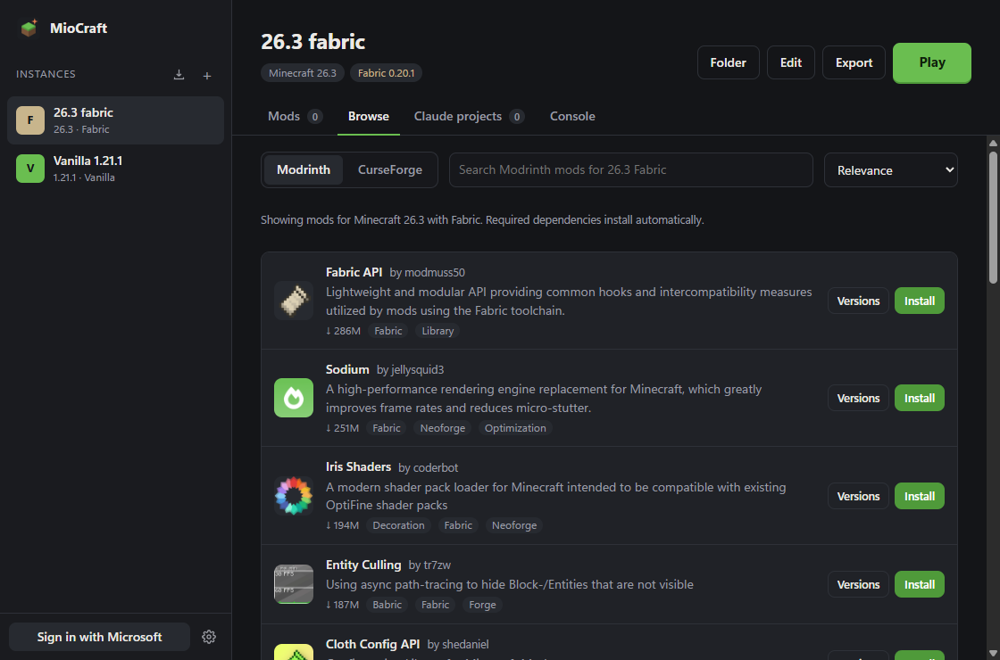
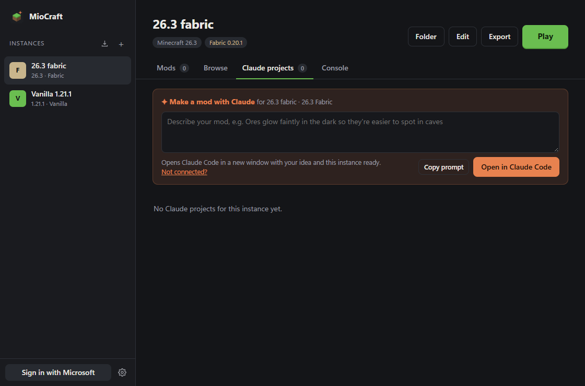

# MioCraft

A lightweight, multi-instance Minecraft: Java Edition launcher for Windows, with
a built-in Modrinth and CurseForge mod browser and Claude Code integration.

**[Download the Windows installer](https://github.com/Kokkogubben/mio-craft/releases/latest)**
· Source: <https://github.com/Kokkogubben/mio-craft>



MioCraft does three things:

1. **Runs as many separate Minecraft setups as you like.** Each instance has its
   own Minecraft version, mod loader, mods, worlds and settings, so a vanilla
   1.21 world, a Fabric modpack and a NeoForge test setup never get in each
   other's way.
2. **Finds and installs mods for you.** The mod browser searches Modrinth and
   CurseForge from inside the launcher and only shows mods that fit the instance
   you're looking at.
3. **Lets Claude Code build mods.** Ask Claude Code for a mod and it creates the
   project, writes the code, builds it and installs it. The mod then shows up in
   the instance's mod list, tagged **✦ Made by Claude**, ready to play.

## Features

**Launcher**

- **Multiple instances** for any Minecraft version in Mojang's list (releases and snapshots), each **vanilla**, **Fabric** or **NeoForge**
- Every instance keeps its **own game folder** (mods, saves, resource packs, logs) and its own memory setting; game files, libraries and Java are shared between instances so they're only downloaded once
- **Java downloaded automatically**: the launcher fetches the Java version each Minecraft version needs
- **Microsoft account sign-in**, with **tokens kept in Windows Credential Manager**, not in a plain file
- **Console** tab with the game's log, and a **crash helper**: when the game crashes, a banner shows what went wrong and which mods were involved
- **First-run setup** that walks through connecting Claude Code, sign-in and CurseForge
- Small: a Tauri app (Rust + a web UI), not Electron

**Mods**

- **Built-in mod browser** for **Modrinth** and **CurseForge**: results are filtered to the instance's Minecraft version and loader, required dependencies install automatically, and downloads are checked against their checksums
- **Mod list** per instance: enable/disable, delete, search, and a *Rebuild* button for Claude-made mods
- **Mod updates**: check browser-installed mods for newer compatible versions and update one or all
- **Modpacks**: import Modrinth `.mrpack` files (Fabric and NeoForge) and export instances to share, with Claude's mods included

**Claude Code**

- **Make a mod with Claude**: describe a mod in the launcher and it opens Claude Code with your idea and the instance ready; "Ask Claude" does the same for changing an existing mod
- **Ask Claude to fix** on the crash banner opens Claude Code with the crash details
- **Live mode** (Fabric on Minecraft 26.x): change the game while it runs: hotswap code, add new blocks and items with live textures, and an experimental mode that registers real content mid-game. Each part is a toggle in the instance's settings
- **Gradle downloaded automatically**, so you don't need to install anything to build mods
- **MCP server for Claude Code** with 31 tools: create instances and mods, build, install, run a test client, read logs and crash reports

## How it fits together

```
 Claude Code ──stdio──► MCP server (mcp/) ──HTTP──┐
                                                  ▼
 Launcher window (ui/) ──HTTP + live events──► launcher core (crates/core)
                                               127.0.0.1, random port, token
```

All the launcher logic lives in `crates/core`. The desktop app (`src-tauri/`) is
a thin shell that starts the core and shows the UI. While the launcher is open,
the core serves a local API on `127.0.0.1`, protected by a random token. It
writes the port and token to `api.json` in the data folder, which is how the MCP
server finds it.

Data lives in `%APPDATA%\MioCraft`:

```
instances/<id>/minecraft/      game folder (mods/, saves/, logs/ …)
instances/<id>/claude-mods.json which jars in mods/ Claude built
instances/<id>/online-mods.json which jars came from Modrinth / CurseForge
exports/                       exported .mrpack modpacks
projects/<mod_id>/             mod source code Claude Code edits (has its own CLAUDE.md)
versions/ libraries/ assets/   shared Minecraft files
java/ gradle/                  downloaded JDKs and Gradle
```

## Getting started

### 1. Build or download

Download the installer from the
[latest release](https://github.com/Kokkogubben/mio-craft/releases/latest). It
isn't code-signed, so Windows SmartScreen will warn the first time you run it.
Every push is also built by the **Build** workflow on
[GitHub Actions](https://github.com/Kokkogubben/mio-craft/actions).

To build locally on Windows you need [Rust](https://rustup.rs), Node 18+ and the
[Tauri prerequisites](https://v2.tauri.app/start/prerequisites/) (WebView2 is
already on Windows 10/11):

```
npm run setup
npm run dev      # run with hot reload
npm run build    # make the installer in target/release/bundle/
```

### 2. Make an instance and add mods

Press **+** next to *Instances*, pick a Minecraft version and a loader (vanilla,
Fabric or NeoForge) and give it a name. The first time you press **Play** the
launcher downloads Minecraft, the loader and Java for that instance. Make as
many instances as you like; **Folder** opens an instance's game folder and
**Edit** changes its settings.

On a Fabric or NeoForge instance, open the **Browse** tab to search Modrinth
(and CurseForge, once you've added a key, see below). Installing a mod also
installs the mods it requires. Installed mods appear on the **Mods** tab, where
you can turn them off, delete them or update them. Vanilla instances can't load
mods.

### 3. Connect Claude Code

The launcher's MCP server runs on [Node.js](https://nodejs.org) (LTS), so install
that alongside [Claude Code](https://claude.com/claude-code). Then open the
launcher, go to **Settings → Connect Claude Code** and press **Connect
automatically**. Or run the command it shows, which looks like this:

```
claude mcp add --scope user mio-craft -- node "C:\Program Files\MioCraft\mcp\mio-craft-mcp.mjs"
```

Keep the launcher open while Claude Code works. Then ask something like:

> Make a Fabric mod for my "Creative Lab" instance that makes ores glow faintly.

Claude Code creates the project, edits the code, runs `build_mod` until it
compiles, installs it with `install_mod`, and can test it in an offline dev client
with `run_dev_client`.



You can also start from the launcher: on an instance's **Claude projects** tab,
describe the mod and press **Open in Claude Code**. A terminal opens with Claude
Code and a prompt that already names the instance, its Minecraft version and
loader, and the tools to use.

### 4. CurseForge (optional)

Modrinth works out of the box. To browse CurseForge too, get a free API key at
[console.curseforge.com](https://console.curseforge.com/) and paste it into
**Settings → CurseForge API key**. Some CurseForge authors don't allow downloads
from other apps; for those, the launcher shows a link to the mod's page so you
can download it yourself and drop it in the mods folder.

### 5. Microsoft sign-in (needed to play)

Testing mods in the dev client needs no account. To **play** an instance you
need to sign in with a Microsoft account that owns Minecraft: Java Edition.
Microsoft requires every third-party launcher to use its own Azure app:

1. Go to [portal.azure.com](https://portal.azure.com) → **App registrations** → **New registration**.
2. Name it (e.g. "MioCraft"). For supported account types choose **Personal Microsoft accounts only**.
3. Leave the redirect URI empty and register.
4. In **Authentication**, set **Allow public client flows** to **Yes** and save.
5. Copy the **Application (client) ID** and paste it into the launcher's **Settings → Azure client ID**.
6. New apps must be approved for the Minecraft API before sign-in works. Submit
   your client ID through Mojang's review form (linked from Microsoft's
   Minecraft launcher documentation). Until approval, sign-in fails at the
   "Minecraft rejected the sign-in" step.

## MCP tools

| Tool | What it does |
|---|---|
| `launcher_status` | Check the launcher is running; data folder, sign-in state |
| `list_instances`, `create_instance` | See or make instances (downloads Minecraft, the loader and Java) |
| `list_minecraft_versions`, `list_loader_versions` | Available versions |
| `list_mods`, `set_mod_enabled` | An instance's mod list |
| `search_online_mods`, `install_online_mod` | Find and install Modrinth / CurseForge mods (with required dependencies) |
| `check_mod_updates`, `update_mods` | Update browser-installed mods |
| `export_modpack` | Export an instance as a `.mrpack` |
| `list_mod_projects`, `get_mod_project`, `create_mod` | Mod projects from version-matched templates |
| `build_mod` | Compile with Gradle; returns compiler errors |
| `install_mod` | Build and install into the instance (replaces older builds) |
| `run_dev_client`, `stop_dev_client`, `read_dev_log` | Offline test client (`gradle runClient`) |
| `launch_game`, `stop_game`, `read_game_log` | Play the real instance; read `latest.log`, raw output or the newest crash report |
| `get_crash_info` | Summary of the latest crash and the mods in its stack trace |
| `get_live_status`, `hotswap_mod` | Live mode state; push code changes into the running game |
| `define_live_block`, `define_live_item`, `remove_live_content` | Add or change content while the game runs |
| `give_live_content`, `run_game_command` | Give live content to the player; run a command in the singleplayer world |

## Version support

- **Playing**: any Minecraft version in Mojang's manifest, including snapshots.
- **Fabric mod templates**: Minecraft 1.14.4 and newer (official Mojang mappings;
  no mappings from 26.1, which is unobfuscated).
- **NeoForge**: Minecraft 1.20.2 and newer (NeoForge doesn't exist for older versions).

## Developing

```
cargo test -p launcher-core                         # core unit + API tests
cargo run -p launcher-core --bin launcher-headless  # the core without a window
cd ui && npx vite                                   # then open http://localhost:5173/?port=<port>&token=<token> from api.json
```

Set `MIO_CRAFT_HOME` to use a separate data folder while developing (both
the core and the MCP server respect it).
## Live mode

Change a game while it runs, without restarting. Open an instance's **Edit**
dialog; the toggles apply the next time you press Play. Fabric on Minecraft
26.1+ only (unobfuscated), singleplayer.

| Toggle | What it does | Stability |
|---|---|---|
| **Hotswap code** | Runs the game on JetBrains Runtime with enhanced class redefinition, Mixin's hot-swap agent, and the launcher's agent. `hotswap_mod` (or ⚡ Hotswap on a project) compiles and pushes only changed classes. Adding methods and fields works; code that only runs at startup doesn't re-run. The jar is updated when the game exits. | Stable |
| **Content slots** | The companion mod pre-registers blank blocks and items (64 of each by default). Claude fills a slot with a name, texture, hardness, light, drops and behaviour code, all live. Behaviour classes reload in a fresh class loader whenever they're recompiled. | Stable |
| **Instant textures** | Paints new textures straight into the block atlas, in spots reserved at startup. Off: textures go into a resource pack and the game reloads resources automatically (a few seconds). | Stable |
| **Unfreeze registries** | Experimental. Registers real blocks and items after startup (both threads paused), patches the lookups Minecraft builds from its registries, then reloads resources for the new models. | Can glitch or crash; back up worlds |

Limits of content slots: light changes apply to blocks placed afterwards, the
slot count is fixed per session, and content keeps the slot's id
(`claude_live:slot_block_3`) in the world. Turning content slots off removes the
companion mod, so blocks placed from slots disappear from worlds.

The companion mod is generated and built by the launcher the first time live
content is enabled (`%APPDATA%\MioCraft\live`), and installed or
removed at each launch to match the toggles. It also installs Fabric API, which
it needs.

## Crashes

If a game crashes (it writes a crash report, or exits with an error), the
instance shows a banner with the crash description, the first exception and the
installed mods that appear in the stack trace. **Ask Claude to fix** opens Claude
Code with all of that. If one of Claude's own mods is involved, it opens in that
mod's project and Claude fixes and reinstalls it. For third-party mods it explains
the problem and asks before changing anything.

## Modpacks

**Import**: the download button next to *Instances* takes a `.mrpack`. Fabric and
NeoForge packs are supported (Forge and Quilt aren't). Files are only downloaded
from the hosts the format allows (Modrinth's CDN, GitHub, GitLab) and checked
against their hashes.

**Export**: *Export* on an instance writes a `.mrpack` to the `exports` folder.
Modrinth mods are linked rather than copied, and mods Claude made are included.
Other mods (from CurseForge or added by hand) are left out unless you tick the
box confirming you're allowed to share them.

## Privacy

MioCraft has no telemetry, analytics or accounts of its own, and nothing is
sent to the author. It only talks to the services it needs:

| Service | When | What is sent |
|---|---|---|
| Mojang (`piston-meta.mojang.com`, `resources.download.minecraft.net`, `libraries.minecraft.net`) | Listing versions, installing an instance | Download requests |
| Fabric, NeoForge, Adoptium, JetBrains, Gradle | Installing a loader, Java or build tools | Download requests |
| Modrinth | Using the mod browser, updates, modpack import | Your search text, the instance's Minecraft version and loader, and which browser-installed mods to check for updates. Imported modpacks may also download files from GitHub or GitLab |
| CurseForge | Only if you add an API key | The same, plus your API key |
| Microsoft, Xbox Live, Minecraft services | Signing in and refreshing the session | The sign-in tokens Microsoft's login flow requires |
| `mc-heads.net` | Showing your player head once signed in | Your Minecraft account UUID |

Sign-in tokens are stored in Windows Credential Manager. The Azure client ID and
CurseForge API key you enter are stored in `config.json` in the data folder. The
local API only listens on `127.0.0.1` and requires a random token that changes
every time the launcher starts.

Claude Code is a separate program you install yourself; what it sends to
Anthropic is covered by its own terms, not by MioCraft.

## Legal

NOT AN OFFICIAL MINECRAFT PRODUCT. NOT APPROVED BY OR ASSOCIATED WITH MOJANG OR
MICROSOFT. Not affiliated with Anthropic either.

Playing an instance requires signing in with a Microsoft account that owns
Minecraft: Java Edition. The only thing that runs without an account is the mod
development test client that Fabric's and NeoForge's own build tools provide
(`gradle runClient`), which is for testing a mod you're building, not for
playing. The launcher downloads game files from
Mojang's servers and doesn't redistribute them.

MioCraft is open source under the [MIT License](LICENSE).
